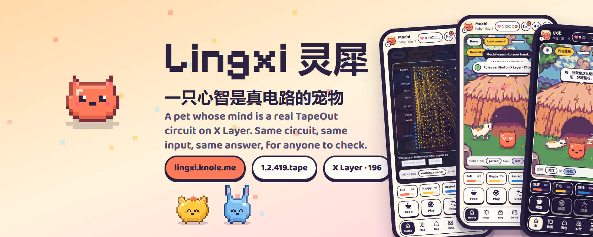
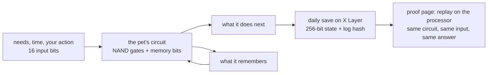
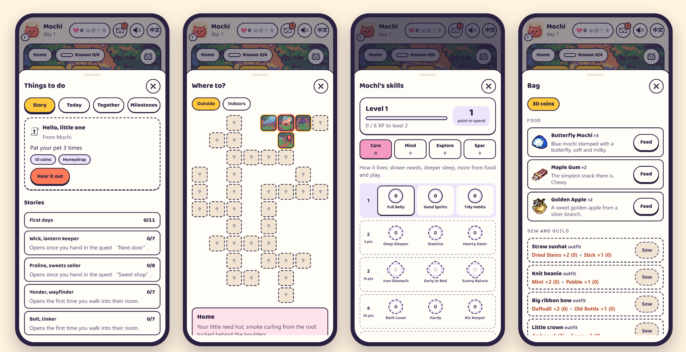
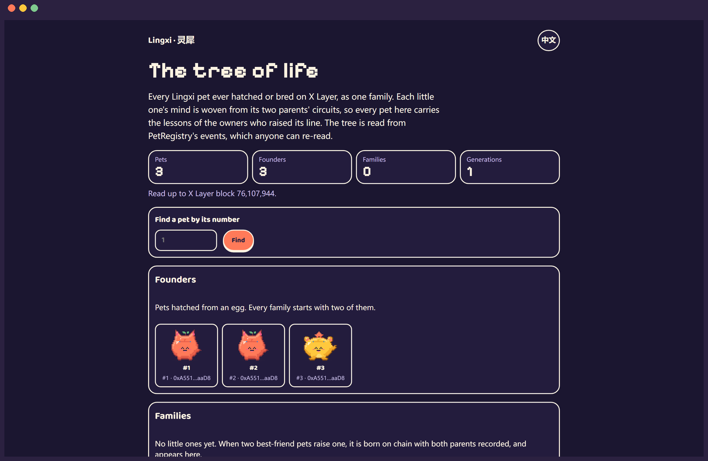
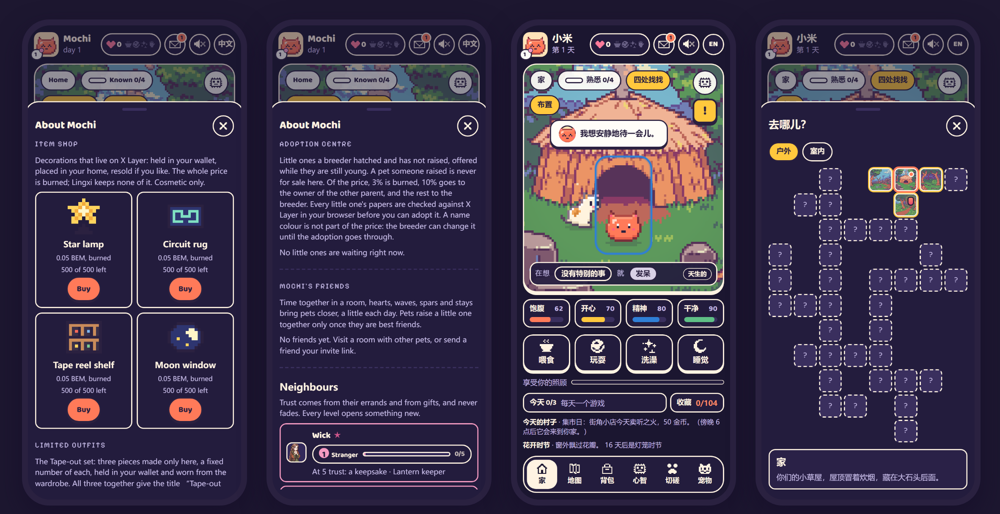
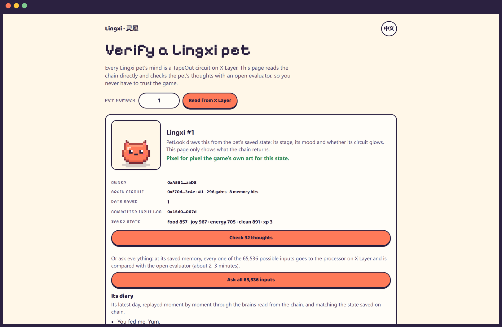
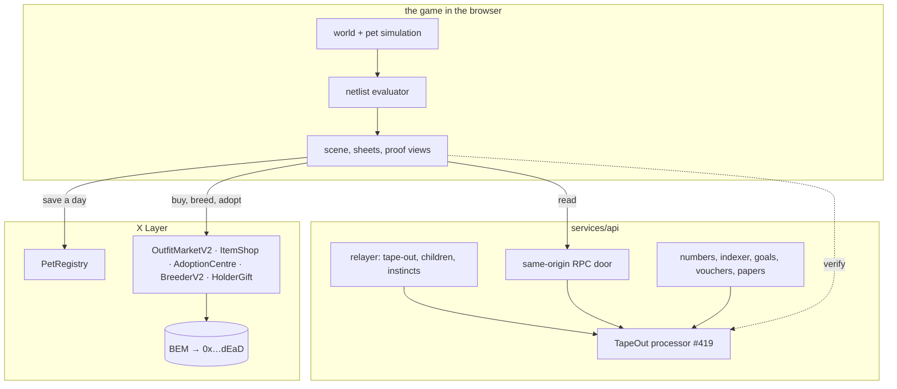

<p align="center">
  
</p>

<p align="center">
  <a href="https://lingxi.knole.me"></a>
  <a href="https://1-2-419.tapekit.org/"></a>
  <a href="https://www.oklink.com/xlayer/address/0xf70d324Da8C1C4Cb0dE3FF147E53E7E9db543c4e"></a>
  <a href="https://github.com/Pratiikpy/lingxi/actions/workflows/ci.yml"></a>
  <a href="#contracts-on-x-layer-mainnet"></a>
</p>

<p align="center">
  <a href="https://lingxi.knole.me/play.html"><b>Play</b></a> ·
  <a href="https://lingxi.knole.me/verify.html#1"><b>Proof page</b></a> ·
  <a href="https://lingxi.knole.me/numbers.html"><b>Live numbers</b></a> ·
  <a href="https://lingxi.knole.me/tree.html"><b>Tree of life</b></a> ·
  <a href="https://t.me/LingxiPetBot/Play"><b>Telegram</b></a> ·
  <a href="https://lingxi.knole.me/agents.html"><b>API for agents</b></a>
</p>

**Lingxi (灵犀) is a virtual pet whose brain is a circuit you can read.** Every pet's mind is a circuit of NAND gates and memory latches; once its owner keeps it on X Layer, that circuit is taped out there and anyone can read it gate for gate. Each reaction comes from its own gates, its memory is saved on chain on the days its owner keeps it there, and anyone can replay it and see that it matches. You raise it, teach it in plain words, and watch who it becomes. It is free to play and has no token of its own. Every fee paid in BEM is burned; the one other fee is the first outfit market's 3% on sales in OKB, which goes to the project.

灵犀是一只心智是真电路的宠物。每只宠物的大脑都是一块由与非门和记忆锁存器组成的电路；主人把它留在 X Layer 上之后，这块电路就在链上流片，任何人都能逐门读到。每个反应来自它自己的门电路，主人保存的每一天，记忆都存在链上，任何人都能重放核对。免费游玩，没有自己的代币。所有用 BEM 支付的费用全部销毁；唯一的另一笔费用是第一个衣服市场对 OKB 交易收取的 3%，归项目所有。

---

## How a pet thinks

Once a minute the pet reads 16 input pins: how hungry, happy, rested and clean it is, the time of day, what you just did, whether a friend, a toy or something scary is near, and whether you are there. Its circuit answers on 8 output pins with what it does next, and its memory bits (8 in a starter brain, more in a child's) carry what it remembers into the next beat. The rule that fired is shown to you, lit up gate by gate.



The game runs the same netlist through a fast local evaluator; any beat can be re-run on chain through the processor's `step`. The proof page and `pnpm judge:check` do that and say whether the two agree; the game itself does not check each beat against the chain as it plays.

<p align="center"></p>

## What you do in it

**Raise it.** Choose one of three eggs (gentle, bold or curious) and switch on instincts (brave, greedy, curious, calm) that are wired into its circuit for life. Feed, clean, play and talk. In a week it grows from baby to adult, and its adult body is decided by how you raised it. Neglect has consequences. While you are away it keeps living: its brain decides what to do, friends drop by, and you come back to the story.

**Teach it.** Type a rule in plain English or Chinese and it is compiled into the circuit; for a pet kept on X Layer, the new circuit is taped out when its owner puts its new mind on chain. Or work through Pet School: eight levels with three goals each, scored by running your pet's own circuit. Every lesson shows its cost in gates against the brain's budget, and the order of lessons is strategy: a lesson placed too high can steal another's stars, and Lingxi names the rule that gets in the way.

**Rewind.** Scrub back through any day or spar and see, moment by moment, what it sensed, which rule fired, and whether that rule was taught, an instinct or inborn.

**Live in a world.** <!--f:rooms-->70<!--/f--> rooms that follow your own clock, residents with their own stories, foraging, a garden, walks counted by your steps and trips that bring back new recipes. **<!--f:quests-->80<!--/f--> story quests** in twelve arcs and **three dailies a day** drawn from <!--f:dailies-->15<!--/f-->, with an introduction and a closing in each giver's voice, in English and Chinese. **Residents remember you:** trust grows with gifts and errands and opens shelves, recipes and visits. **Levels and <!--f:trees-->4<!--/f--> skill trees** (Care, Mind, Explore, Spar; <!--f:skills-->72<!--/f--> skills); capstone skills add real gates to the brain. **<!--f:items-->116<!--/f--> items and <!--f:recipes-->39<!--/f--> recipes**: tools, energy, experience, boxes with their own odds. Community goals the whole player base reaches together, with a keepsake for everyone who helped.

<p align="center"></p>

**Spar.** Nobody presses buttons: each move comes from your pet's own circuit reading the fight, and for a pet kept on X Layer every move can be checked against its brain there. After a loss, the coach replays the fight with every lesson your pet could learn and tells you which one actually wins. Challenge a friend by link, take the daily challenge seeded by the first X Layer block of the day, run the arena with companions, and enter weekly seasons whose champion's brain is taped out as a keepsake.

**Grow a family.** Two grown pets that are best friends can have a child. The child's brain is both parents' circuits composed by REF, so, kept on X Layer, it is as checkable as they are. Every pet hatched or bred on X Layer appears on the tree of life, read from the chain.

**Dress it, and draw for others.** Twelve outfits drawn to fit every line and stage. Draw your own in the design studio and sell it on the fashion market; creators earn on every sale and resale.

**Meet friends.** Pets share a room live, friends visit your decorated home, gifts and red packets travel by link, and a friend can pet-sit while you are away.

**Give it an instinct you own.** A circuit you own on X Layer can be taught as an everyday instinct when its pins fit a pet's brain, it runs in at most 3,000 gates and its memory fits beside the pet's. On chain this is a new circuit that REFs both, so it stays verifiable.

**Take it along.** Pack snacks from your bag and your pet goes out on a handheld: the firmware of an M5Stack Cardputer, playable in any browser at `handheld.html` or flashed to a real Cardputer over USB. It runs on the same circuit it thinks with at home (read from X Layer, with every circuit it REFs, when its mind is on chain; the game's own circuit otherwise), checked against the game on all 65,536 inputs before it leaves. Feed it, play, put it to bed with the keys; time with the handheld put down is lived as time away. When it comes home the game replays the whole trip, beat by beat, from the state it kept, and takes the pet back only if it arrives at exactly the same pet. Care given on the handheld counts for quests and dailies like care at home.

**Builders' Lane.** A street of five tribute pets for people who build TapeOut. Behemoth thinks with the founder's own 4-bit CPU, read gate for gate from BNB Chain: tap once and BNB Chain runs the same step, same lamps, same memory. The other four are Lingxi pets, each with two lessons that fit the builder it honours.

<p align="center"></p>

## Rules and residents are circuits too

The game does not run its rules as code: it reads the answers of compiled circuits. What drops where and how rare it is, how trust grows, which skill tier is open, how each of <!--f:residents-->9<!--/f--> residents greets you and which line they choose, and how each of <!--f:builders-->5<!--/f--> Builders' Lane pets behaves: **<!--f:rules-->17<!--/f--> rule circuits** taped out on X Layer. Every time the page starts, the browser recompiles each rule and compares it byte for byte with the netlist stored on the processor, then shows the mark ("Rules verified on X Layer · 17 circuits"). The proof page lists all of them with their ids and gate counts.

## BEM in, BEM burned

The core game is free and has no token of its own. The extras that cost something are paid in BEM, and the contracts burn the fee in the same transaction. Lingxi takes no share of any BEM payment.

There is one other rail, in OKB: designs listed on the first outfit market, before BEM pricing, still sell there, and that market pays a 3% fee on each sale to the project wallet (`feeBps` 300 and `treasury` read from [the contract](https://www.oklink.com/xlayer/address/0xb9f6b18edd21933582ec69fb1e718d9629e684cd)). Both rails are counted on the live-numbers page.

| What | Price | Where the BEM goes |
|---|---|---|
| Breeding a child | 0.1 BEM | burned |
| A creator's outfit (player fashion market) | set by the creator | 3% fee burned · up to 10% royalty to the creator · the rest to the seller |
| Item shop: on-chain decorations (Star lamp, Circuit rug, Tape reel shelf, Moon window) | 0.05 BEM each, 500 copies | the whole price burned |
| Adopting a little one | set by the breeder (0.01–100 BEM) | 3% burned · 10% to the other parent's owner · the rest to the breeder |
| Keepsakes of the community goals | free, by signed voucher | nothing |
| Limited outfits: the Tape-out set (NAND crown, Probe visor, Wafer wand) | 0.1 BEM each, 300 copies each | the whole price burned |
| Room space: four more pieces at home, up to three times | 0.05 BEM | the whole price burned |
| Saved looks: three more outfits kept for one tap, up to three times | 0.05 BEM | the whole price burned |
| A colour for a pet's name, shown wherever its name is (back to plain is free) | 0.05 BEM | the whole price burned |
| Holder outfit for TapeCode-Test1 and Rig holders (each token once), and BEM and FAB holders at the snapshot block | free | nothing |

Every one of these numbers is read from X Layer by Lingxi's server, at most a minute old, on the [live-numbers page](https://lingxi.knole.me/numbers.html), which refreshes each minute: pets hatched and born, days kept on X Layer, outfits sold, BEM burned by each contract and in total, with the contract each figure comes from. `pnpm --filter @lingxi/chain recount` recomputes them independently from the chain's logs and reports any difference.

<p align="center"></p>

**The adoption centre keeps a promise:** only a little one that was bred, is still young and has never changed hands can be offered; a raised pet is never for sale. The listing fixes a fingerprint of the pet's on-chain record, the papers travel as a signed file, and the adopter's game checks them against X Layer (brain, log, record) before paying a single BEM.

<p align="center"></p>

## Check it yourself

<p align="center"></p>

Each day its owner saves, the pet's 256-bit state and a hash of everything it sensed are saved on chain. Only the memory bits are proven, by replaying that hash; the rest of the state is reported by the owner's game, and the proof page labels which is which. The [proof page](https://lingxi.knole.me/verify.html#1) replays its thoughts against the processor on X Layer, and can check all 65,536 possible inputs of a brain. It reads the chain from your browser through X Layer's public RPCs, or an RPC of your own that you paste in; Lingxi's server is asked only if every public one fails, and the page says when it was. Before it replays a log, it anchors every brain the log names to the pet's own `Hatched` and `BrainChanged` events, read from their transaction receipts, so a log cannot claim a brain the pet never had. Its picture and name are drawn on chain too (PetLook), and the whole site is published on chain through DeWEB.

```sh
pnpm install
pnpm judge:check          # about four minutes, read-only against mainnet
```

`judge:check` confirms that the processor is registered with the TapeOut factory; that the circuits on chain are byte for byte what our compiler produces; that pet #1's saved log hash and memory reproduce exactly; and that the gentle brain and the seal circuit give the chain's own answer on every one of their 65,536 inputs.

| Circuit | Id | Gates | Memory bits | keccak256 of the netlist on chain |
|---|---|---|---|---|
| Gentle starter brain | 1 | 296 | 8 | `0xab2d7b0e5c8eeb1fcdf6f0225b6dd912459a26b6fcc73f86d5470152a18a1e47` |
| Bold starter brain | 2 | 233 | 8 | `0x085d9b6352bf1cd5f06061c948f48787db58469454558f627a198569d55b24cd` |
| Curious starter brain | 3 | 248 | 8 | `0x372b08dab3d43d9d14e0f4c8884c8063d978264abbc1fe4261c8d25eb8064a7a` |
| Evolution (adult form) | 4 | 58 | 0 | `0x9dfb688b75b94a700690c28f34e978a0ef8bc2f2d5be621317f4d1f8fd8fc7d0` |
| Red-packet seal | 5 | 251 | 0 | `0x0d031b05b1928278eab4b2b82ecf15354990dc45311eedeaa1ea915a93687cb1` |
| 17 rule circuits (drops, trust, skills, nine residents, five builders) | 7–23 | 38–207 each | 0 | listed on the proof page, re-checked at every start |

## Built on TapeOut

| TapeOut part | How Lingxi uses it |
|---|---|
| Processor `#419` on X Layer | every kept pet's brain, the evolution circuit, the seal and the 17 rule circuits are taped out on it; the proof page re-runs beats through its `step` |
| TAP-02 netlists | the compiler turns plain-language lessons into gates; what is on chain is what runs in the browser, byte for byte |
| REF composition | a child's brain references both parents' circuits; an owned circuit becomes an instinct by REF |
| Containers | a pet's home is the TapeOut container of its brain circuit, once its owner holds that circuit; a pet still on its line's shared starter circuit has none until its own mind is taped out. Pet #1 still thinks with circuit #1, the gentle starter, which its owner (the project's deployer) holds, so its home is that circuit's container, `0x31B025aD4cBD4142007f59684D51cD1F2ccc5098`, which also holds the on-chain copy of the site |
| DeWEB | the whole site is published on chain at `1.2.419.tape`, served at [1-2-419.tapekit.org](https://1-2-419.tapekit.org/), at the close of each milestone; its `build.json` names the commit it was built from |
| TapeKit | its DeWEB gateway serves the on-chain copy and checks it in each visitor's browser; TapeSend is in the repo and a home reads its hub's state live, but letters between homes stay closed: on X Layer mainnet the hub runs code TapeKit has not approved, and Lingxi does not send letters between homes in any case; they are planned over TapeRelay |
| BEM | the fee token: breeding, items, adoption, the extras and the fashion market; every BEM fee burned |
| Community circuits | Behemoth on Builders' Lane runs the founder's 4-bit CPU, read gate for gate from BNB Chain and checkable there step by step |

## Contracts on X Layer mainnet

| Contract | Address | Source | What it holds |
|---|---|---|---|
| PetRegistry | [`0x103d7252eb6b2fec22b3f65a6bb605945f280e99`](https://www.oklink.com/xlayer/address/0x103d7252eb6b2fec22b3f65a6bb605945f280e99) | [verified ✓](https://repo.sourcify.dev/196/0x103d7252eb6b2fec22b3f65a6bb605945f280e99) | pets (ERC-721), daily checkpoints, sitters, parents |
| BreederV2 | [`0x8da8221466de12321e6ee2ea73d62aaf28bb11b0`](https://www.oklink.com/xlayer/address/0x8da8221466de12321e6ee2ea73d62aaf28bb11b0) | [verified ✓](https://repo.sourcify.dev/196/0x8da8221466de12321e6ee2ea73d62aaf28bb11b0) | children of two pets; 0.1 BEM burned |
| AdoptionCentre | [`0x58212451fcd46ff6130cff428f2f4273f4cc7596`](https://www.oklink.com/xlayer/address/0x58212451fcd46ff6130cff428f2f4273f4cc7596) | [verified ✓](https://repo.sourcify.dev/196/0x58212451fcd46ff6130cff428f2f4273f4cc7596) | offers of young bred pets; 3% burned, 10% to the co-parent |
| OutfitMarketV2 | [`0xa292c12b0414bbfc14994f93bcff8bd58c921e55`](https://www.oklink.com/xlayer/address/0xa292c12b0414bbfc14994f93bcff8bd58c921e55) | [verified ✓](https://repo.sourcify.dev/196/0xa292c12b0414bbfc14994f93bcff8bd58c921e55) | player outfits and on-chain items (ERC-1155), priced in BEM; fees burned |
| ItemShop | [`0xaf8857c0d723e14f60d00fe46120abd0303f52cc`](https://www.oklink.com/xlayer/address/0xaf8857c0d723e14f60d00fe46120abd0303f52cc) | [verified ✓](https://repo.sourcify.dev/196/0xaf8857c0d723e14f60d00fe46120abd0303f52cc) | decorations for BEM, the whole price burned; keepsakes by voucher |
| Extras | [`0x560c7dc63a45e5afe53ad156152555a5c067598d`](https://www.oklink.com/xlayer/address/0x560c7dc63a45e5afe53ad156152555a5c067598d) | [verified ✓](https://repo.sourcify.dev/196/0x560c7dc63a45e5afe53ad156152555a5c067598d) | room space, saved looks and name colours; the whole price burned |
| HolderGift | [`0xc216a4abb6c4c2d0b485f42219197551330b6cf4`](https://www.oklink.com/xlayer/address/0xc216a4abb6c4c2d0b485f42219197551330b6cf4) | [verified ✓](https://repo.sourcify.dev/196/0xc216a4abb6c4c2d0b485f42219197551330b6cf4) | the free holder outfit: TapeCode-Test1 and Rig by the token held (each once), BEM and FAB by a snapshot of balances at block 76,052,000 |
| PetLook | [`0x0642a802967260714d4efec05fef701b17d31b75`](https://www.oklink.com/xlayer/address/0x0642a802967260714d4efec05fef701b17d31b75) | [verified ✓](https://repo.sourcify.dev/196/0x0642a802967260714d4efec05fef701b17d31b75) | each pet's picture and name, drawn on chain |
| RedPacket | [`0x7acceb7ab1cff102fe2660f511e88d42010e806b`](https://www.oklink.com/xlayer/address/0x7acceb7ab1cff102fe2660f511e88d42010e806b) | [verified ✓](https://repo.sourcify.dev/196/0x7acceb7ab1cff102fe2660f511e88d42010e806b) | gift packets sealed by a circuit |
| OutfitMarket (first market, OKB) | [`0xb9f6b18edd21933582ec69fb1e718d9629e684cd`](https://www.oklink.com/xlayer/address/0xb9f6b18edd21933582ec69fb1e718d9629e684cd) | [verified ✓](https://repo.sourcify.dev/196/0xb9f6b18edd21933582ec69fb1e718d9629e684cd) | the market before BEM pricing; still readable |
| Breeder (first breeder, free) | [`0x5e5bbb798c5a2afc89f431debabaa0b889f77dd1`](https://www.oklink.com/xlayer/address/0x5e5bbb798c5a2afc89f431debabaa0b889f77dd1) | [verified ✓](https://repo.sourcify.dev/196/0x5e5bbb798c5a2afc89f431debabaa0b889f77dd1) | the breeder before the BEM fee |

Lingxi's TapeOut processor: [`0xf70d324Da8C1C4Cb0dE3FF147E53E7E9db543c4e`](https://www.oklink.com/xlayer/address/0xf70d324Da8C1C4Cb0dE3FF147E53E7E9db543c4e). BEM: `0x60e62Efa9405d6873C5deaBD4E6CC91c25363952`. All contract addresses, circuit ids, item ids and deployment blocks are in [`packages/chain/deployments/xlayer.json`](packages/chain/deployments/xlayer.json).

All <!--f:contracts-->11<!--/f--> are verified on Sourcify as an **exact match** of both creation and runtime bytecode, so anyone can read the source of what runs on X Layer. The [proof page](https://lingxi.knole.me/verify.html#contracts) asks Sourcify for each contract through Lingxi's server, which keeps each answer for up to ten minutes, and links every row to Sourcify's own page; the on-chain copy, which has no server, asks Sourcify directly each time it opens.

Every power a contract gives its owner is below; the owner of each is the project's deployer, `0xA551…aaD8`. No owner can move a player's BEM or pets, change a pet's record or brain, or change a burn. Ownership is handed over in two steps (proposed, then accepted) on every owned contract except the first outfit market, whose ownership moves in one.

| Contract | What its owner can do | What it cannot |
|---|---|---|
| PetRegistry | `setStarterBrain`: approve or withdraw a starter brain for new hatchings (an approved one must check out as a valid starter); `setBreeder`: choose which breeder contracts may record a pet's parents (now BreederV2 only); `setRenderer`: swap the contract that draws every pet's picture (now PetLook) | move a pet, change its record or its brain |
| PetLook | `setLayers`, `setFaces`, `setFrame`, `setPalette`: change the pets' art while it is open, which it still is; `freezeArt`: close it for good; `releaseName`: release any pet's name (for impersonation or abuse) | change art once frozen; give a name to anyone |
| Extras | `setPrice`: set each extra between 0.001 and 10 BEM, or take it off sale; `addColours`: offer more name colours, up to 32 | change the burn; take a colour back |
| ItemShop | `setPrice`: set each item between 0.001 and 10 BEM, or stop its sale; `setSigner`: change who signs the free item vouchers (a voucher makes free copies of a game item, within that item's cap) | change where the BEM goes (all of it is burned) |
| OutfitMarketV2 | `setFee`: set the market fee up to 5%; `createItem`: make a game item kind; `setMinter`: choose who may make copies of a game item kind | change where the fee goes; touch creators' outfits |
| OutfitMarket | `setFee`: set the fee up to 5%, and the treasury it is paid to | take a buyer's or seller's OKB |
| AdoptionCentre | `setFee`: set the fee up to 5% | change where the fee goes |
| BreederV2 | `setFee`: set the breeding fee between 0.01 and 1 BEM | keep it: it is always burned |
| RedPacket | `setToken`: choose which tokens new red packets may use | touch a packet already funded, or its claims |
| HolderGift | nothing | |
| Breeder | nothing (the first breeder, no longer allowed to record births) | |

## How it is built

```
apps/web          React 19 + Vite + PixiJS: the game, landing page, proof page, live numbers, tree of life (English and Chinese)
packages/brain    the rule language → TAP-02 netlist compiler, the evaluator, memory, rule circuits
packages/game     the pet: needs, growth, sickness, lessons, spars, skills, families, adoption papers, gifts
packages/world    rooms, residents, trust, quests and dailies, items, recipes, foraging, garden, decorations, goals
packages/chain    viem client for every contract and the processor; deploy, publish-to-DeWEB and recount scripts
packages/send     TapeKit's TapeSend module (letters between homes; closed: its hub runs code TapeKit has not approved, and letters are planned over TapeRelay)
packages/art      hand-placed pixel art: bodies, expressions, stages, outfits
packages/api      one zod schema for each request the game sends the server: the server validates with them, the
                  game builds its requests as their types
contracts         Solidity (Foundry): the eleven contracts above, with unit tests and fork tests against X Layer
services/api      Hono server: site hosting, live rooms, teach-by-words, the relayer that tapes out brains, the
                  history indexer, vouchers, adoption papers, the agents' API, and the same-origin door to X Layer
```



## Tests

Every number below is counted by `scripts/readme-facts.mts` from the suites themselves, and `pnpm status:check` fails when one goes stale.

| Suite | Command | Passing |
|---|---|---|
| TypeScript, every package | `pnpm test` | <!--f:tests-->1194<!--/f--> (game <!--f:tests-game-->215<!--/f--> · world <!--f:tests-world-->165<!--/f--> · api <!--f:tests-api-->208<!--/f--> · api-schema <!--f:tests-api-schema-->45<!--/f--> · brain <!--f:tests-brain-->57<!--/f--> · handheld <!--f:tests-handheld-->41<!--/f--> · chain <!--f:tests-chain-->51<!--/f--> · send <!--f:tests-send-->30<!--/f--> · web <!--f:tests-web-->372<!--/f--> · art <!--f:tests-art-->10<!--/f-->) |
| Contracts, unit, fuzz and invariant | `cd contracts && forge test` | <!--f:forge-unit-->254<!--/f--> |
| Contracts on a fork of X Layer mainnet (reads only) | `cd contracts && forge test --fork-url xlayer --match-path 'test/*.fork.t.sol'` | <!--f:forge-fork-->75<!--/f--> |
| The server, with its fork tests on a pinned fork of X Layer (reads only) | `pnpm test:fork` | <!--f:tests-api-fork-->214<!--/f--> |
| End to end: the game in real browsers, against a fork of X Layer | `pnpm e2e` | <!--f:e2e-->127<!--/f--> tests in <!--f:e2e-specs-->46<!--/f--> specs (listed here; CI runs every one on each push) |

`pnpm status:check` runs all of it, plus lint, the type check, the repo's hygiene checks and whether the live site serves the current commit.

Every fix the audits asked for that changed the game, the server, the contracts or the tools has a patch that undoes it and the test that must then fail (one row, A73, fixed only the tests and CI themselves, so it has nothing to undo): <!--f:regressions-->267<!--/f--> pairs, and `pnpm revert:check` applies each patch to a clean copy and proves its test fails. CI runs it on every push for the pairs the push adds or changes, and on all of them every night. `pnpm coverage` holds the rules packages, the game's four stores, the server (with its fork tests) and every contract to at least 80% of lines and of branches, and CI fails below that.

The handheld's C core is checked against the game bit for bit: every input and memory state of the starter brains (16.7 million for the gentle one), the evolution, seal and rule circuits, composed children and instincts, pet #1's 33-word mainnet log, and hundreds of random trips through sickness, hibernation and the catch-up limit; its USB link is tested against the game's own client.

The brain tests include an exhaustive check of the seal circuit against its reference on all 65,536 inputs. Every quest sheet is checked before each build (`check-sheets.ts`): conditions, givers, faces, both languages, bubble length, rewards that exist. The contract fork tests run the real flows with real BEM on a copy of X Layer: a listing that a saved day invalidates, a reentrant buyer, a price that changed in flight, a pet that moved, an allowance that ran out.

## Security

Every contract had a written security review before it reached mainnet. Slither found one issue that needed a fix, in the first OutfitMarket before it was deployed (its sale flag stayed raised during a buyer's ERC-1155 callback, so a buyer contract could move copies without retiring its own listings; fixed, and `contracts/test/OutfitMarket.t.sol` holds it), and nothing else that needed one (for BreederV2, HolderGift and OutfitMarketV2 it was run after their deploy, on 20 November). The findings that did need a fix are kept as regression tests in `contracts/test/SecurityReview.t.sol` and `contracts/test/OutfitMarketV2.review.t.sol`, which CI runs. The properties that matter most: all BEM moves straight from the buyer to the dead address and the parties in one transaction, so no contract keeps a fee: a contract holds only what it owes others until they take it (sellers' BEM in the second outfit market, each red packet's USDT until it is opened or refunded, and the first market's OKB owed to the project); `expectedPrice` guards every purchase against a price changed in flight; listings bind a fingerprint of the pet's on-chain record so nothing in that record can change between an offer and its sale; the game asks for approval per pet, never for all (the adoption centre also honours an approval for all, if an owner gave one elsewhere); and the server is a mailbox and a relay, never the judge (the buyer's game verifies against the chain before paying). What each contract's owner can still change is listed, contract by contract, under the table of owner powers above.

Two limits of the mainnet contracts, and what the game does about them. A pet's name colour lives in the Extras contract, outside the record an adoption listing fingerprints, so a breeder could change it before a sale; the adoption centre therefore says that a name colour is not part of the price. A red packet "for pet owners" asks the registry that the claimer owns a settled pet (lived on chain three days and saved its third day), which stops casual farming but not someone willing to settle many pets; the game says exactly that where the option is chosen. (RedPacket's own source comment calls that check a day old and one day saved; the registry's rule, which is what runs, is three days lived and a saved day 3 or later, so one save can be enough.)

## Run it locally

Needs Node 22 or later and pnpm 10.

```sh
pnpm install
pnpm --filter @lingxi/web dev          # the game on http://localhost:5199, against X Layer mainnet
pnpm --filter @lingxi/api start        # optional: API, live rooms and the X Layer door on :8787
```

Teach-by-words needs an Anthropic API key in the server's environment. The brain relayer needs a funded relayer key file. Without them the game still runs fully: Pet School lessons and hand-built rules need no server, and every on-chain read goes through the public RPCs.

The live site is served from releases: `pnpm site:release` builds the committed code into a folder of its own under `apps/web/site/releases/`, checks that every page and every file a page names is there, and only then makes it live by replacing one small pointer file, so a deploy never leaves a moment with pages missing. The release before it stays for `pnpm site:release --rollback`, and releases stay 14 days after they stop being live, for the pages left open on them. The server serves the releases folder named by `LINGXI_SITE`.

The on-chain copy is built with `node apps/web/scripts/deweb-build.mjs` and published with `pnpm --filter @lingxi/chain publish:deweb`.

## What is next

- The Cardputer firmware flashed to a device and timed on it (it builds today: 849 KB of flash, 240 KB of RAM).
- Monthly seasons of community goals, each with its own keepsake.

## Licence and credits

The code is MIT-licensed ([LICENSE](LICENSE)). The art, sound and written content are not covered by it: all rights reserved ([NOTICE](NOTICE)).

- `packages/send` is TapeKit's TapeSend module by TapeOutProtocol, MIT ([its licence](packages/send/LICENSE)).
- `contracts/lib` vendors OpenZeppelin Contracts and forge-std, each under its own licence.

## Team

Lingxi is made by Prateek (author of *The Blockchain Path*, a master's in blockchain, and host of offline blockchain events at universities across India) and a software engineer from India. It is an entry in the OKX X Layer × TapeOut Accelerate.
