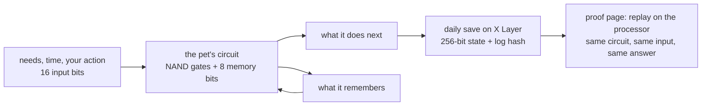
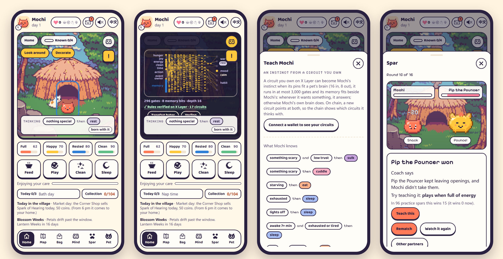
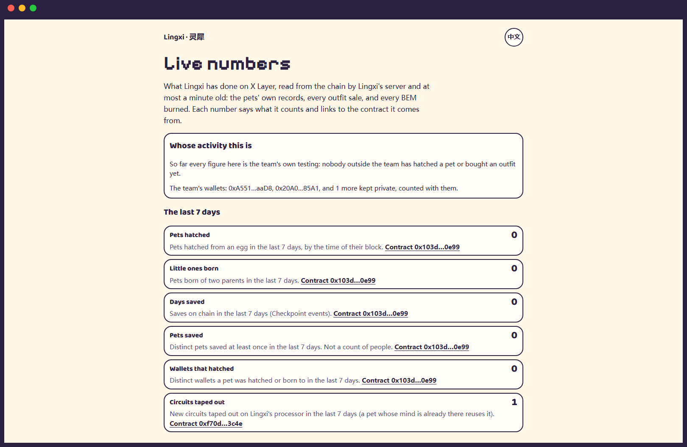
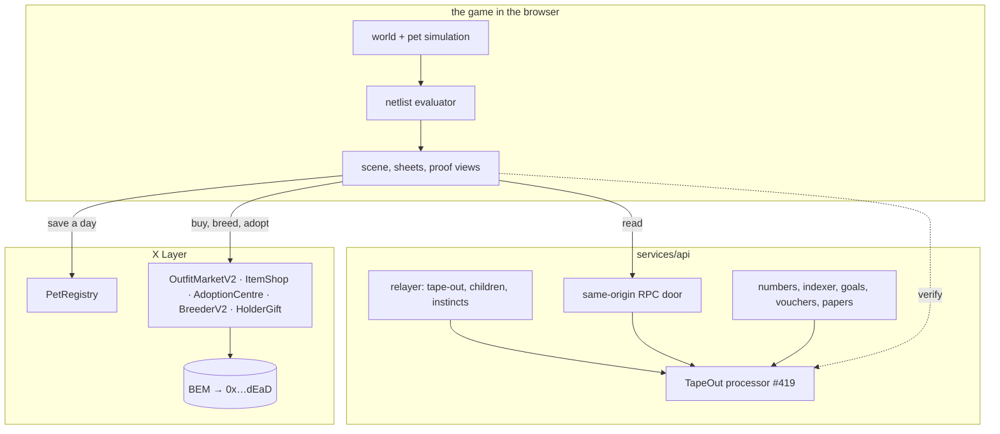

<p align="center">
  
</p>

<p align="center">
  <a href="https://lingxi.knole.me"></a>
  <a href="https://1-2-419.tapekit.org/"></a>
  <a href="https://www.oklink.com/xlayer/address/0xf70d324Da8C1C4Cb0dE3FF147E53E7E9db543c4e"></a>
  <a href="#tests"></a>
  <a href="#contracts-on-x-layer-mainnet"></a>
</p>

<p align="center">
  <a href="https://lingxi.knole.me/play.html"><b>Play</b></a> ·
  <a href="https://lingxi.knole.me/verify.html#1"><b>Proof page</b></a> ·
  <a href="https://lingxi.knole.me/numbers.html"><b>Live numbers</b></a> ·
  <a href="https://lingxi.knole.me/tree.html"><b>Tree of life</b></a> ·
  <a href="https://t.me/LingxiPetBot/Play"><b>Telegram</b></a> ·
  <a href="https://lingxi.knole.me/agents.html"><b>API for agents</b></a>
</p>

**Lingxi (灵犀) is a virtual pet whose brain is a circuit you can read.** Every pet's mind is a TapeOut circuit of NAND gates and memory latches, taped out on X Layer. Each reaction comes from its own gates, its daily memory is saved on chain, and anyone can replay it and see that it matches. You raise it, teach it in plain words, and watch who it becomes. It is free to play, there is no token, and every fee in it is paid in BEM and burned.

灵犀是一只心智是真电路的宠物。每只宠物的大脑都是 X Layer 上的一块 TapeOut 电路，每个反应来自它自己的门电路，每天的记忆存在链上，任何人都能重放核对。免费游玩，没有代币，所有费用用 BEM 支付并全部销毁。

---

## How a pet thinks

Once a minute the pet reads 16 input pins: how hungry, tired, dirty, bored and happy it is, the time of day, and what you just did. Its circuit answers with what it does next, and 8 memory bits carry what it remembers into the next beat. The rule that fired is shown to you, lit up gate by gate.



The game runs the same netlist through a fast local evaluator; any beat can be re-run on chain through the processor's `step`. A pet's thoughts are only ever claimed when the two agree.

<p align="center"></p>

## What you do in it

**Raise it.** Choose one of three eggs (gentle, bold or curious) and switch on instincts (brave, greedy, curious, calm) that are wired into its circuit for life. Feed, clean, play and talk. Over two weeks it grows from baby to adult, and its adult body is decided by how you raised it. Neglect has consequences. While you are away it keeps living: its brain decides what to do, friends drop by, and you come back to the story.

**Teach it.** Type a rule in plain English or Chinese and it is compiled into the circuit and taped out. Or work through Pet School: eight levels with three goals each, scored by running your pet's own circuit. Every lesson shows its cost in gates against the brain's budget, and the order of lessons is strategy: a lesson placed too high can steal another's stars, and Lingxi names the rule that gets in the way.

**Rewind.** Scrub back through any day or spar and see, moment by moment, what it sensed, which rule fired, and whether that rule was taught, an instinct or inborn.

**Live in a world.** Seventy rooms that follow your own clock, residents with their own stories, foraging, a garden, walks counted by your steps and trips that bring back new recipes. **80 story quests** in twelve arcs and **three dailies a day**, with an introduction and a closing in each giver's voice, in English and Chinese. **Residents remember you:** trust grows with gifts and errands and opens shelves, recipes and visits. **Levels and four skill trees** (Care, Mind, Explore, Spar, 72 skills); capstone skills add real gates to the brain. **122 items and 42 recipes**: tools, energy, experience, boxes with their own odds. Community goals the whole player base reaches together, with a keepsake for everyone who helped.

<p align="center"></p>

**Spar.** Nobody presses buttons: each move comes from your pet's own circuit reading the fight, and every move can be checked against the brain on X Layer. After a loss, the coach replays the fight with every lesson your pet could learn and tells you which one actually wins. Challenge a friend by link, take the daily challenge seeded by the first X Layer block of the day, run the arena with companions, and enter weekly seasons whose champion's brain is taped out as a keepsake.

**Grow a family.** Two grown pets that are best friends can have a child. The child's brain is both parents' circuits composed by REF, so every thought it has is still checkable. Every pet ever hatched or bred appears on the tree of life, read from X Layer.

**Dress it, and draw for others.** Twelve outfits drawn to fit every line and stage. Draw your own in the design studio and sell it on the fashion market; creators earn on every sale and resale.

**Meet friends.** Pets share a room live, friends visit your decorated home, gifts and red packets travel by link, and a friend can pet-sit while you are away.

**Give it an instinct you own.** Any circuit you own on X Layer can be taught as an everyday instinct. On chain this is a new circuit that REFs both, so it stays verifiable.

**Builders' Lane.** A street of pets whose brains are circuits from the TapeOut community, read gate for gate from the chain. Behemoth thinks with the founder's own 4-bit CPU: tap once and the chain runs the same step, same lamps, same memory.

<p align="center"></p>

## Rules and residents are circuits too

The game does not run its rules as code: it reads the answers of compiled circuits. What drops where and how rare it is, how trust grows, which skill tier is open, how each of nine residents greets you and which line they choose, and how each of five Builders' Lane pets behaves: **17 rule circuits** taped out on X Layer. Every time the page starts, the browser recompiles each rule and compares it byte for byte with the netlist stored on the processor, then shows the mark ("Rules verified on X Layer · 17 circuits"). The proof page lists all of them with their ids and gate counts.

## BEM in, BEM burned

The core game is free and there is no token. The extras that cost something are paid in BEM, and the contracts burn the fee in the same transaction. Lingxi keeps no BEM.

| What | Price | Where the BEM goes |
|---|---|---|
| Breeding a child | 0.1 BEM | burned |
| A creator's outfit (player fashion market) | set by the creator | 3% fee burned · up to 10% royalty to the creator · the rest to the seller |
| Item shop: on-chain decorations (Star lamp, Circuit rug, Tape reel shelf, Moon window) | 0.05 BEM each, 500 copies | the whole price burned |
| Adopting a little one | set by the breeder (0.01–100 BEM) | 3% burned · 10% to the other parent's owner · the rest to the breeder |
| Keepsakes of the community goals | free, by signed voucher | nothing |
| Holder outfit for BEM, FAB and TapeCode-Test1 holders | free | nothing |

Every one of these numbers is read live from the chain on the [live-numbers page](https://lingxi.knole.me/numbers.html): pets hatched and born, days kept on X Layer, outfits sold, BEM burned by each contract and in total, with the contract each figure comes from. `pnpm --filter @lingxi/chain recount` recomputes them independently from the chain's logs and reports any difference.

<p align="center"></p>

**The adoption centre keeps a promise:** only a little one that was bred, is still young and has never changed hands can be offered; a raised pet is never for sale. The listing fixes a fingerprint of the pet's on-chain record, the papers travel as a signed file, and the adopter's game checks them against X Layer (brain, log, record) before paying a single BEM.

<p align="center"></p>

## Check it yourself

<p align="center"></p>

Each day the pet's 256-bit state and a hash of everything it sensed are saved on chain. The [proof page](https://lingxi.knole.me/verify.html#1) replays its thoughts against the processor on X Layer, and can check all 65,536 possible inputs of a brain. Its picture and name are drawn on chain too (PetLook), and the whole site is published on chain through DeWEB.

```sh
pnpm install
pnpm judge:check          # about 3.5 minutes, read-only against mainnet
```

`judge:check` confirms that the processor is registered with the TapeOut factory; that the circuits on chain are byte for byte what our compiler produces; that pet #1's saved log hash and memory reproduce exactly; and that the gentle brain and the seal circuit give the chain's own answer on every one of their 65,536 inputs.

| Circuit | Id | Gates | Memory bits | keccak256 of the netlist on chain |
|---|---|---|---|---|
| Gentle starter brain | 1 | 296 | 8 | `0xab2d7b0e5c8eeb1fcdf6f0225b6dd912459a26b6fcc73f86d5470152a18a1e47` |
| Bold starter brain | 2 | 233 | 8 | `0x085d9b6352bf1cd5f06061c948f48787db58469454558f627a198569d55b24cd` |
| Curious starter brain | 3 | 248 | 8 | `0x372b08dab3d43d9d14e0f4c8884c8063d978264abbc1fe4261c8d25eb8064a7a` |
| Evolution (adult form) | 4 | 58 | 0 | `0x9dfb688b75b94a700690c28f34e978a0ef8bc2f2d5be621317f4d1f8fd8fc7d0` |
| Red-packet seal | 5 | 251 | 0 | `0x0d031b05b1928278eab4b2b82ecf15354990dc45311eedeaa1ea915a93687cb1` |
| 17 rule circuits (drops, trust, skills, nine residents, five builders) | 7–23 | 38–207 each | 0 | listed on the proof page, re-checked at every start |

## Built on TapeOut

| TapeOut part | How Lingxi uses it |
|---|---|
| Processor `#419` on X Layer | every pet brain, the evolution circuit, the seal and the 17 rule circuits are taped out on it; the proof page re-runs beats through its `step` |
| TAP-02 netlists | the compiler turns plain-language lessons into gates; what is on chain is what runs in the browser, byte for byte |
| REF composition | a child's brain references both parents' circuits; an owned circuit becomes an instinct by REF |
| Containers | a pet's home is a TapeOut container; pet #1's is `0x31B025aD4cBD4142007f59684D51cD1F2ccc5098` |
| DeWEB | the whole site is published on chain at `1.2.419.tape`, served at [1-2-419.tapekit.org](https://1-2-419.tapekit.org/) |
| TapeKit | TapeSend letters between homes and the Telegram Mini App |
| BEM | the fee token: breeding, items, adoption and the fashion market; all fees burned |
| Community circuits | Builders' Lane runs circuits from the TapeOut community, read from the chain |

## Contracts on X Layer mainnet

| Contract | Address | Source | What it holds |
|---|---|---|---|
| PetRegistry | [`0x103d7252eb6b2fec22b3f65a6bb605945f280e99`](https://www.oklink.com/xlayer/address/0x103d7252eb6b2fec22b3f65a6bb605945f280e99) | [verified ✓](https://repo.sourcify.dev/196/0x103d7252eb6b2fec22b3f65a6bb605945f280e99) | pets (ERC-721), daily checkpoints, sitters, parents |
| BreederV2 | [`0x8da8221466de12321e6ee2ea73d62aaf28bb11b0`](https://www.oklink.com/xlayer/address/0x8da8221466de12321e6ee2ea73d62aaf28bb11b0) | [verified ✓](https://repo.sourcify.dev/196/0x8da8221466de12321e6ee2ea73d62aaf28bb11b0) | children of two pets; 0.1 BEM burned |
| AdoptionCentre | [`0x58212451fcd46ff6130cff428f2f4273f4cc7596`](https://www.oklink.com/xlayer/address/0x58212451fcd46ff6130cff428f2f4273f4cc7596) | [verified ✓](https://repo.sourcify.dev/196/0x58212451fcd46ff6130cff428f2f4273f4cc7596) | offers of young bred pets; 3% burned, 10% to the co-parent |
| OutfitMarketV2 | [`0xa292c12b0414bbfc14994f93bcff8bd58c921e55`](https://www.oklink.com/xlayer/address/0xa292c12b0414bbfc14994f93bcff8bd58c921e55) | [verified ✓](https://repo.sourcify.dev/196/0xa292c12b0414bbfc14994f93bcff8bd58c921e55) | player outfits and on-chain items (ERC-1155), priced in BEM; fees burned |
| ItemShop | [`0xaf8857c0d723e14f60d00fe46120abd0303f52cc`](https://www.oklink.com/xlayer/address/0xaf8857c0d723e14f60d00fe46120abd0303f52cc) | [verified ✓](https://repo.sourcify.dev/196/0xaf8857c0d723e14f60d00fe46120abd0303f52cc) | decorations for BEM, the whole price burned; keepsakes by voucher |
| HolderGift | [`0xc216a4abb6c4c2d0b485f42219197551330b6cf4`](https://www.oklink.com/xlayer/address/0xc216a4abb6c4c2d0b485f42219197551330b6cf4) | [verified ✓](https://repo.sourcify.dev/196/0xc216a4abb6c4c2d0b485f42219197551330b6cf4) | the free holder outfit, checked against balances on chain |
| PetLook | [`0x0642a802967260714d4efec05fef701b17d31b75`](https://www.oklink.com/xlayer/address/0x0642a802967260714d4efec05fef701b17d31b75) | [verified ✓](https://repo.sourcify.dev/196/0x0642a802967260714d4efec05fef701b17d31b75) | each pet's picture and name, drawn on chain |
| RedPacket | [`0x7acceb7ab1cff102fe2660f511e88d42010e806b`](https://www.oklink.com/xlayer/address/0x7acceb7ab1cff102fe2660f511e88d42010e806b) | [verified ✓](https://repo.sourcify.dev/196/0x7acceb7ab1cff102fe2660f511e88d42010e806b) | gift packets sealed by a circuit |
| OutfitMarket (first market, OKB) | [`0xb9f6b18edd21933582ec69fb1e718d9629e684cd`](https://www.oklink.com/xlayer/address/0xb9f6b18edd21933582ec69fb1e718d9629e684cd) | [verified ✓](https://repo.sourcify.dev/196/0xb9f6b18edd21933582ec69fb1e718d9629e684cd) | the market before BEM pricing; still readable |
| Breeder (first breeder, free) | [`0x5e5bbb798c5a2afc89f431debabaa0b889f77dd1`](https://www.oklink.com/xlayer/address/0x5e5bbb798c5a2afc89f431debabaa0b889f77dd1) | [verified ✓](https://repo.sourcify.dev/196/0x5e5bbb798c5a2afc89f431debabaa0b889f77dd1) | the breeder before the BEM fee |

Lingxi's TapeOut processor: [`0xf70d324Da8C1C4Cb0dE3FF147E53E7E9db543c4e`](https://www.oklink.com/xlayer/address/0xf70d324Da8C1C4Cb0dE3FF147E53E7E9db543c4e). BEM: `0x60e62Efa9405d6873C5deaBD4E6CC91c25363952`. All contract addresses, circuit ids, item ids and deployment blocks are in [`packages/chain/deployments/xlayer.json`](packages/chain/deployments/xlayer.json).

All ten are verified on Sourcify as an **exact match** of both creation and runtime bytecode, so anyone can read the source of what runs on X Layer. The [proof page](https://lingxi.knole.me/verify.html#contracts) asks Sourcify live each time it opens.

Owner powers are deliberately small: fees move only within fixed bounds, burn shares cannot change, and no contract can move a player's BEM or pets. Ownership is two-step everywhere.

## How it is built

```
apps/web          React 19 + Vite + PixiJS: the game, landing page, proof page, live numbers, tree of life (English and Chinese)
packages/brain    the rule language → TAP-02 netlist compiler, the evaluator, memory, rule circuits
packages/game     the pet: needs, growth, sickness, lessons, spars, skills, families, adoption papers, gifts
packages/world    rooms, residents, trust, quests and dailies, items, recipes, foraging, garden, decorations, goals
packages/chain    viem client for every contract and the processor; deploy, publish-to-DeWEB and recount scripts
packages/send     TapeKit's TapeSend module (letters between homes)
packages/art      hand-placed pixel art: bodies, expressions, stages, outfits
contracts         Solidity (Foundry): the ten contracts above, with unit tests and fork tests against X Layer
services/api      Hono server: site hosting, live rooms, teach-by-words, the relayer that tapes out brains, the
                  history indexer, vouchers, adoption papers, the agents' API, and the same-origin door to X Layer
video             the demo and launch videos, cut with Remotion from scripted recordings of the live game
```



## Tests

```sh
pnpm test
# 575 tests: game 206 · world 144 · api 84 · brain 57 · chain 34 · send 30 · web 16 · art 4

cd contracts && forge test
# 87 unit tests, including fuzz tests

cd contracts && forge test --fork-url https://xlayerrpc.okx.com --fork-block-number <head - 2000>
# 62 fork tests of every contract against the live registry, BEM and the TapeOut factory
```

The brain tests include an exhaustive check of the seal circuit against its reference on all 65,536 inputs. Every quest sheet is checked before each build (`check-sheets.ts`): conditions, givers, faces, both languages, bubble length, rewards that exist. The contract fork tests run the real flows with real BEM on a copy of X Layer: a listing that a saved day invalidates, a reentrant buyer, a price that changed in flight, a pet that moved, an allowance that ran out.

## Security

Every contract had a written review and a Slither pass before it reached mainnet; the reviews and their fixes are recorded with the build notes. The properties that matter most: all BEM moves straight from the buyer to the dead address and the parties in one transaction, so no contract ever holds a balance to steal; `expectedPrice` guards every purchase against a price changed in flight; listings bind a fingerprint of the pet's on-chain record so nothing can change between an offer and its sale; approvals are per pet, never for all; and the server is a mailbox and a relay, never the judge (the buyer's game verifies against the chain before paying). One trust assumption to know: PetRegistry's owner chooses which breeder contracts may record a pet's parents.

## Run it locally

```sh
pnpm install
pnpm --filter @lingxi/web dev          # the site on http://localhost:5173
pnpm --filter @lingxi/api start        # API, live rooms and the X Layer door on :8787
```

Teach-by-words needs an Anthropic API key in the server's environment. The brain relayer needs a funded relayer key file. Without them the game still runs fully: Pet School lessons and hand-built rules work offline, and every on-chain read goes through the public RPCs.

The on-chain copy is built with `node apps/web/scripts/deweb-build.mjs` and published with `pnpm --filter @lingxi/chain publish:deweb`.

## What is next

- A pet's brain running on a real handheld, loading its netlist by id and running it beat by beat.
- Monthly seasons of community goals, each with its own keepsake.

## Team

Lingxi is made by Prateek (author of *The Blockchain Path*, a master's in blockchain, and host of offline blockchain events at universities across India) and a software engineer from India. It is an entry in the OKX X Layer × TapeOut Accelerate.
